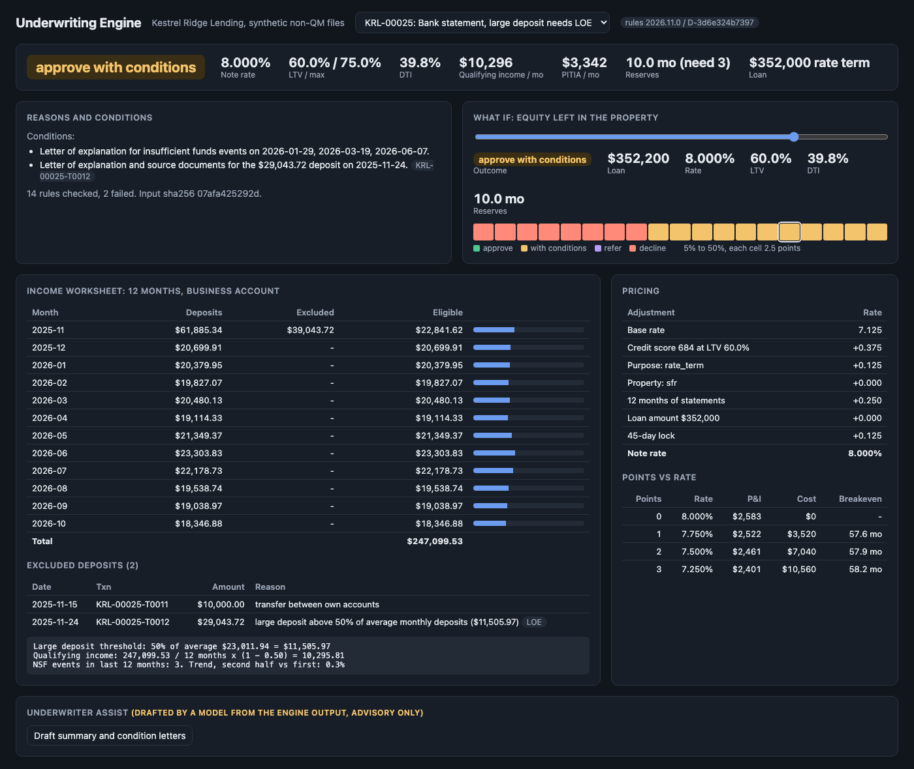

# Underwriting Engine

A mortgage underwriting decision engine for Kestrel Ridge Lending, a made-up non-QM lender that serves self-employed borrowers and real estate investors. It takes a loan file (borrower, credit, 12 or 24 months of transaction-level bank statements, property, loan request) and returns a priced, explainable decision: approve, approve with conditions, refer to manual underwriting, or decline with ordered adverse action reasons. Eligibility and pricing rules are versioned YAML, every decision records the rules version and hash that produced it, and a `diff-rules` command shows which applications would change decision before a new version ships. All data is synthetic and seeded.



**Example decision** (`uv run uwengine decide data/samples/KRL-00025.json`):

```
KRL-00025  APPROVE_WITH_CONDITIONS  rules 2026.11.0  rate 8.000%
  ltv                        0.5997       max_ltv 0.75
  qualifying_income          10295.81     = 247,099.53 eligible deposits / 12 months x (1 - 0.50)
  dti                        0.3975       pitia 3342.14
  reserves_months            10.01        required 3
  condition: Letter of explanation for insufficient funds events on 2026-01-29, 2026-03-19, 2026-06-07.
  condition: Letter of explanation and source documents for the $29,043.72 deposit on 2025-11-24.
```

A decline lists its principal reasons in priority order, in plain language (`KRL-00079`):

```
  reason 1 (NSF): Your bank statements show 10 insufficient funds events in the last 12 months.
  reason 2 (RESERVES): After closing you would have 1.1 months of payments in reserve. We require 6.
```

## Results on 300 seeded applications

| Measure | Value |
|---|---|
| Outcomes under rules 2026.11.0 | 112 approve, 45 approve with conditions, 39 refer, 104 decline |
| Files with a large deposit excluded and flagged for a letter of explanation | 69 |
| Engine time per decision (laptop, pure Python) | about 4.5 ms |
| `diff-rules` 2026.11.0 to candidate 2027.01.0 (300 + 7 sample files) | 28 of 307 change decision: 15 approve to refer, 13 to decline. 135 approvals repriced, mean -12.5 bps |
| Fair lending monitoring, current rules | 1 alert: group_b approval rate ratio 0.78 (p = 0.11) |

The fair lending alert is a useful example. The generator draws the monitoring group independently of every underwriting input, so this gap is sampling noise in a group of 83 decided files, and the p-value says so. The four-fifths rule on its own fires on small samples. That is why the report carries a p-value and a matched-band pricing comparison, and why an alert starts a review instead of reaching a conclusion.

## Why

Non-QM lending runs on judgment-heavy documentation: a contractor's income is whatever survives a careful read of 24 months of deposits. When that read lives in spreadsheets and underwriter habit, three problems follow. Two underwriters reach different numbers on the same file. Nobody can say which version of the credit policy approved a loan from last spring. And a policy change (raise the FICO floor, tighten DSCR) ships without anyone knowing how many pipeline loans it flips. This project shows the system that fixes those: income worksheets traceable to individual deposits, rules as versioned data with an effective date, a decision record that names its rules version and hash, and impact analysis that runs in CI before a rules change merges.

## Architecture

```
 loan file (JSON)                                          rules/*.yaml  (version, effective_date, sha256)
   borrower, statements, property, loan                        │ select_version(application_date)
   monitoring {protected_group} ──┐                            ▼
        │                         │ stored apart       ┌──────────────── engine.decide ─────────────────┐
        │ to_engine_input()       ▼                    │ 1 eligibility: state, FICO, loan limits, LTV    │
        │ drops monitoring   monitoring table          │ 2 price: base + LLPA grid + overlays + lock     │
        ▼                         │                    │ 3 income: bank-statement worksheet or DSCR      │
   EngineInput ───────────────────┼──────────────────▶ │ 4 DTI / DSCR / NSF / trend / reserves checks    │
   (no field for monitoring)      │                    │ 5 outcome + ordered reasons + conditions        │
                                  │                    └───────────────┬─────────────────────────────────┘
                                  │                                    ▼
                                  │                    Decision: outcome, reasons, conditions, pricing,
                                  │                    worksheets, every rule check, rules version + hash
                                  │                                    │
                                  ▼                                    ▼
                    fair lending monitoring              SQLite audit store (append-only triggers)
                    (joins groups to finished decisions)   │                │
                                                           ▼                ▼
                                             Claude assist (advisory)   FastAPI + web UI
```

| Piece | File |
|---|---|
| Domain model, `EngineInput` without monitoring | `src/uwengine/models.py` |
| Bank-statement income and DSCR worksheets | `src/uwengine/income.py` |
| Rules loading, validation, version selection | `src/uwengine/rules.py`, `rules/*.yaml` |
| LLPA pricing, points ladder | `src/uwengine/pricing.py` |
| Decision engine and what-if | `src/uwengine/engine.py` |
| Impact analysis (`diff-rules`) | `src/uwengine/impact.py` |
| Fair lending monitoring | `src/uwengine/fairlending.py` |
| Claude summary and condition letters | `src/uwengine/llm.py` |
| Seeded synthetic loan files | `src/uwengine/synth.py`, `data/samples/` |
| API, metrics, JSON logs | `src/uwengine/app.py`, `metrics.py`, `logs.py` |
| Web UI (one HTML file, plain JS, light and dark) | `src/uwengine/static/index.html` |

### Income

Bank-statement income follows the usual non-QM method:

1. Take every credit on the statements. Exclude transfers between the borrower's own accounts and refunds.
2. Average the remaining deposits per month. Any single deposit above `large_deposit_pct` (50% in the current rules) of that average is excluded and becomes a condition: "Letter of explanation and source documents for the $29,043.72 deposit on 2025-11-24."
3. Qualifying income = eligible deposits / months x (1 - expense factor). The factor depends on business type (30% for consulting, 70% for trucking). Personal accounts use 0.

The worksheet lists each month (gross, excluded, eligible), each excluded transaction with its id and reason, and the formula with the real numbers. Tests check that the month rows sum to the total and that every excluded dollar appears as a line item.

DSCR for investor loans is market rent / PITIA, where PITIA is principal and interest at the note rate plus taxes, insurance and HOA. The note rate depends on the DSCR band, so the engine prices once without the DSCR adjustment, computes DSCR, then prices again.

### Rules as versioned data

`rules/uw-rules-2026.11.0.yaml` holds the credit score by LTV grids per program and purpose, max DTI with a manual review margin, minimum DSCR with a refer floor, reserves in months, loan limits, jumbo LTV cuts, state overlays (NY: 5 points less LTV and +0.125 rate; FL: 3 more months of reserves), ineligible states, the LLPA grid, and the adverse action reason catalog with priorities. The engine has no thresholds in code.

The engine picks the rules in effect on the application date. `rules/uw-rules-2026.07.0.yaml` still decides files dated before 2026-11-01. Candidate versions live in `rules/candidate/` until they are released. A loader validates grid shapes and ordering and rejects duplicate versions.

### Decisions and adverse action

- **Decline** when any hard rule fails. Reasons are sorted by the priority in the rules file and capped at four, the way an adverse action notice lists principal reasons. The full list of failed checks stays in the audit record.
- **Refer** when a ratio lands in a manual review band (DTI 50% to 55%, DSCR 0.75 to 1.00), NSFs reach 4, or eligible deposits fall 25% or more from the first half of the period to the second.
- **Approve with conditions** for open items: large deposit letters, NSF letters, a second appraisal above $1.5M.
- Every decision stores the engine input, its sha256, the rules version and file hash, the engine version, and each rule check with actual value, limit, and the outcome if it fails.

### Fair lending monitoring

Each synthetic applicant has a `monitoring.protected_group` attribute, used only for monitoring. The engine cannot see it: `EngineInput` has no field for it, `decide()` refuses a `LoanFile`, a test scans the decision path source for the attribute name, and another test decides 60 files under each of the three group values and requires identical results. The API stores monitoring data in its own table.

The report computes, per group: approval rate (refers left out, since no credit decision has been made), adverse impact ratio against the group with the highest approval rate, a two-proportion p-value, raw mean note rate difference, and a rate difference within matched program, credit band and LTV band strata. A ratio under 0.80 (the four-fifths rule) or a matched rate gap over 12.5 bps raises an alert.

**This is monitoring, not a legal conclusion.** An alert means a person should look. It does not establish disparate impact or treatment, and a clean report does not establish their absence. Real fair lending analysis needs legal review, proper proxy methods where data is not collected, and regression controls well beyond this.

### Claude integration

`POST /decisions/{id}/assist` writes an underwriter summary and one draft letter per condition. The default provider is an offline template. Set `UW_LLM_PROVIDER=anthropic` and `ANTHROPIC_API_KEY` (with the `claude` extra) to use `claude-opus-5-5`.

The model never makes or changes the decision. Credit decisions must be reproducible (same file, same rules, same answer), explainable down to the rule and the number, and backed by specific adverse action reasons. A language model gives none of those guarantees. So the engine decides; the model receives the finished decision as read-only facts with a system prompt that says it is final; its output is labeled advisory; and nothing it returns is parsed back into the decision. A test uses a fake client that answers "DECLINE" on an approved file and checks that the stored decision stays approved. The model also never receives monitoring data.

## How to run

Requires [uv](https://docs.astral.sh/uv/). Docker is optional; the Docker image is built and smoke tested in CI.

```bash
make install                 # uv sync --python 3.12
make run                     # http://127.0.0.1:8782
```

```bash
uv run uwengine decide data/samples/KRL-00025.json            # one decision, add --full for the audit record
uv run uwengine diff-rules                                    # current vs candidate rules, markdown impact report
uv run uwengine fair-lending                                  # monitoring report on 300 seeded files
```

API:

```bash
curl -s -XPOST localhost:8782/decide -H 'content-type: application/json' -d '{"sample_id":"KRL-00025"}'
curl -s localhost:8782/decisions/D-...                        # stored audit record, including the engine input
curl -s -XPOST localhost:8782/what-if -H 'content-type: application/json' \
  -d '{"sample_id":"KRL-00025","variations":[{"down_payment_pct":0.2},{"lock_days":60},{"points":1}]}'
curl -s -XPOST localhost:8782/what-if -H 'content-type: application/json' \
  -d '{"sample_id":"KRL-00025","down_payment_range":{"from":0.05,"to":0.5,"step":0.05}}'
curl -s -XPOST localhost:8782/decisions/D-.../assist          # summary and condition letters (advisory)
curl -s localhost:8782/fair-lending
curl -s localhost:8782/healthz
curl -s localhost:8782/metrics                                # uw_decisions_total, uw_http_requests_total, latency histogram
```

`POST /decide` also accepts `{"loan_file": {...}}` and an optional `rules_version`. Logs are one JSON object per line with a request id that is echoed in `x-request-id`.

## Tests

119 tests, all offline, run in about 20 seconds:

```bash
make test        # uv run --python 3.12 --group dev pytest -q
make lint        # uvx ruff check . and ruff format --check
```

- **Income** (15): hand-built statements, expense factors, transfer and refund exclusion, large deposit exclusion with its date, the exact-threshold edge, 24-month averaging, NSFs only in the last 12 months, trend, worksheet totals that trace to every deposit, amortization and DSCR math.
- **Rule tables** (48): loading, hashing, validation errors, version selection on effective date edges, and every edge of every table: each of the 12 bank-statement max LTV cells at and just over the limit, FICO floors, loan limits, jumbo cut, DTI approve/refer/decline bands, reserves, NSF thresholds, time in business, state overlays, ineligible states, declining deposits, DSCR approve/refer/decline.
- **Pricing** (10): LLPA cell lookup, inclusive band edges, line items that sum to the rate, lock periods, points buydown, floor, DSCR bands, points ladder breakeven.
- **Engine** (15): outcomes, dated conditions, adverse action ordering by priority instead of check order, the four-reason cap, plain-language text, determinism, what-if.
- **Diff and fair lending** (12): no-op diff, a 630 FICO file flipping under the candidate, DSCR minimum change, markdown, `$GITHUB_STEP_SUMMARY` output, the `--fail-over` gate, the four-fifths edge at exactly 0.80, refers excluded, matched-band pricing gap, p-values.
- **Protected attribute isolation** (6): no field on `EngineInput`, source scan of the decision path, identical decisions across group values, independence in the generator, nothing sent to the model.
- **API** (13): decide and fetch, monitoring stored apart, rules version override, validation errors, what-if, metrics, append-only store, assist with mock and a fake Claude client.

## DevOps

- `.github/workflows/ci.yml`: lint and tests; a `rules-impact` job that runs `diff-rules` between `rules/uw-rules-2026.11.0.yaml` and `rules/candidate/uw-rules-2027.01.0.yaml` and writes the impact table, plus the fair lending report under the candidate rules, to the job summary through `$GITHUB_STEP_SUMMARY`; a Docker build with a container smoke test.
- `diff-rules --fail-over 0.10` exits 1 when more than 10% of applications change decision, so a team can turn the report into a gate.
- `Dockerfile`: multi-stage uv build, slim runtime, non-root user, `HEALTHCHECK` on `/healthz`.
- `Makefile`: `install`, `test`, `lint`, `run`, `diff-rules`, `fair-lending`, `samples`, `screenshot`, `docker-build`.

## Production notes

- The synthetic portfolio stands in for the pipeline. In production, `diff-rules` would replay the last 90 days of stored engine inputs, which the audit store already keeps, and the release would need sign-off from credit policy and compliance on the impact report.
- The large deposit rule compares each deposit to average monthly deposits, so a borrower paid by a few large invoices gets many letters of explanation. Real guidelines let underwriters clear recurring sources, which needs a source-matching step and a reviewer queue.
- Rules would live in a reviewed repository with a schema, signed releases, and a rule-authoring UI for credit policy, with the engine loading them by version from storage instead of the image.
- SQLite with triggers shows append-only intent. At scale the audit record goes to an immutable store (WORM object storage or a ledger table) with retention set by the regulator, and decisions are keyed to the loan origination system's loan number.
- Fair lending analysis would run on real HMDA-style data with proxy methods where needed, regression controls, and legal review; this report would feed that process, not replace it.
- The Claude assist would sit behind the same audit trail (prompt hash, model, tokens, who sent the letter), and a person approves every letter before it goes to a borrower.

## License

MIT. See [LICENSE](LICENSE).
